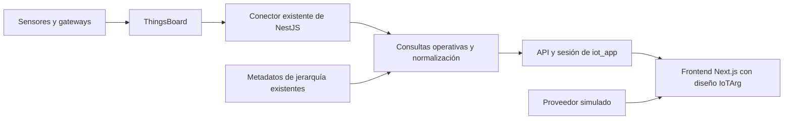

# TBD — Integración de IoTArg con ThingsBoard

Fecha de referencia: 2026-10-20. Documento de propuesta para la siguiente etapa. `TBD` identifica las decisiones pendientes; la existencia de este spec no acredita una conexión verificada con la cuenta actual.

## Objetivo y resultado esperado

Llevar el diseño y el recorrido de [IoTArg](../../../designs/IoTArg.html) al frontend de `iot_app`, usando su backend y su integración existente con ThingsBoard. El primer resultado es un recorrido autenticado: elegir cliente → ver ubicaciones reales en el mapa → abrir un dispositivo → consultar su última lectura, historial disponible y alarmas.

La demo de portfolio conserva un proveedor simulado reproducible. La vista conectada identifica su origen y muestra únicamente información real del alcance autorizado. El estado de ejecución se registra en [tasks.md](../tasks.md).

## Base inspeccionada

La investigación anterior se hizo en lectura sobre el repositorio hermano `../iot_app` (ruta relativa a la raíz de `iol-new`). Las rutas de código de la tabla siguiente son relativas a la raíz de `iot_app`. No se consultó la instancia de ThingsBoard ni se ejecutó su aplicación durante esa investigación. Las pruebas históricas registradas allí no demuestran el estado actual de la cuenta.

| Pieza | Evidencia en `iot_app` | Uso propuesto |
| --- | --- | --- |
| Frontend Next.js App Router, React y TanStack Query | `frontend/package.json`, `frontend/src/app/` | Portar componentes y recorrido visual de IoTArg. |
| Backend NestJS con Fastify | `backend/src/main.ts`, `backend/src/app.module.ts` | Conservar API, sesión y controles de acceso como punto de entrada. |
| Conector HTTP de ThingsBoard | `backend/src/thingsboard/thingsboard-client.service.ts` | Centralizar acceso al proveedor y manejo de autenticación. |
| Redis y Prisma/Postgres | `backend/src/thingsboard/redis.service.ts`, `backend/prisma/schema.prisma` | Reutilizar sesiones, caché y metadatos de jerarquía existentes. |
| Telemetría y alarmas | `backend/src/telemetry/`, `backend/src/alarms/` | Reutilizar consultas; telemetría tiene WS y alarmas tienen polling/diff cada 7 s según el código inspeccionado. |
| Mapa y detalle actuales | `frontend/src/app/map/page.tsx`, `frontend/src/app/entities/[id]/page.tsx` | Mantener rutas de detalle y evaluar la convivencia de la vista geográfica con el mapa de flota Leaflet. |

El registro `.paul/STATE.md` de `iot_app` describe verificaciones históricas contra ThingsBoard Cloud PE y un vencimiento de prueba que afectó clientes/assets. Una nota posterior registra cambios adicionales. Se debe verificar edición, versión, plan y entidades vigentes antes de usar esa información como base de implementación.

## Arquitectura propuesta

`iot_app` es el destino propuesto de la aplicación conectada. `iol-new` conserva la maqueta, la cartografía y estas especificaciones como referencia. Antes de editar el repositorio destino, revisar sus instrucciones, estado Git y contratos actuales, y asignar las rutas exactas de cada corte.

La interfaz consume un contrato normalizado. La adaptación de objetos ThingsBoard y el agregado por cliente/ubicación se resuelven en servicios del backend, respetando el mapeo existente a `EntityRef`. El frontend reutiliza su cliente de API y sesión; las credenciales ThingsBoard permanecen en el servidor.

El primer corte puede componer endpoints existentes para uno o dos dispositivos. Antes de ampliar el mapa a muchas entidades, medir el número de consultas y sustituir cualquier consulta por dispositivo sin límite por consultas agrupadas, caché o un agregado del backend. Ya existe un fan-out por entidad en la consulta global de alarmas: no multiplicarlo desde la interfaz.

Esta ruta reemplaza la propuesta de crear desde cero otro scaffold Next.js en `iol-new`. Los requisitos APP-002 a APP-007 de [design.md](../design.md) siguen siendo criterios de referencia; APP-001 se satisface para esta ruta mediante instalación, build y tipos reproducibles de la aplicación existente. No se presupone que esos checks ya pasen.

## Correspondencia del dominio

| Concepto IoTArg | Fuente propuesta | Regla |
| --- | --- | --- |
| Cliente | Customer de ThingsBoard | Conservar UUID y alcance autorizado. |
| Ubicación / Site | Asset del nivel correspondiente de la jerarquía existente | Asociar coordenadas y nombre; no crear una segunda entidad solo para el mapa. |
| Área | Asset del nivel Area y relaciones existentes | Soportar varias áreas mediante identidad propia. |
| Activo | Asset y relaciones `Contains` | Resolver pertenencia desde la jerarquía, no desde nombres. |
| Dispositivo | Device de ThingsBoard | Conservar UUID; puede emitir varias mediciones. |
| Medición | Clave de telemetría de un Device | Identidad compuesta por dispositivo y clave; unidad y tipo declarados. |
| Alarma | Alarm de ThingsBoard | Conservar identidad, severidad, estado y tiempos del proveedor. |
| País / provincia | Metadatos geográficos acordados o asignación derivada y revisada | Usar códigos compatibles con la cartografía; geometría disponible no implica cobertura IoT. |
| Solución | Clasificación de negocio pendiente | No inferirla únicamente del nombre del dispositivo. |

La maqueta genera un “dispositivo” por métrica. Esta relación no es válida automáticamente para ThingsBoard. La UI conectada distingue **dispositivos** de **mediciones**; usa “sensores” solo cuando el inventario permita identificar sensores físicos sin duplicarlos por cada clave.

Para instalaciones fijas, proponer coordenadas en atributos del Asset Site o en la fuente de metadatos ya acordada. Para activos móviles, usar telemetría de posición con timestamp. El mapa actual de `iot_app` lee `latitude`/`longitude` de telemetría: comprobar las claves reales y acordar una única fuente por tipo de entidad. Una ubicación sin coordenadas válidas permanece en la lista como “Sin ubicación”; no recibe coordenadas ficticias.

## Contratos existentes y proyección de la vista

| API existente de `iot_app` | Respuesta observada / uso |
| --- | --- |
| `GET /customers` y `GET /devices` | Listas paginadas. `/devices` devuelve `EntityRef`, sin lecturas, unidad, coordenadas ni estado operativo completos. |
| `GET /entities/:id/telemetry/keys?type=DEVICE` | Descubrimiento de claves disponibles. |
| `GET /entities/:id/telemetry/latest?type=DEVICE&keys=...` | Mapa por clave con `{ value: string, ts: number }`; normalizar tipo/unidad sin perder timestamp. |
| `GET /entities/:id/telemetry/timeseries` | Historial; confirmar parámetros, límites y agregación en el contrato del backend antes de consumirlo. |
| `GET /alarms`, `GET /entities/:id/alarms?type=DEVICE` | Alarmas paginadas con severidad y estado ThingsBoard. |
| WS `/ws/telemetry` y `/ws/alarms` | Canales existentes del backend; reutilizar autenticación, suscripción y cancelación. |

Como propuesta, una consulta operativa del backend puede devolver `OperationsOverview` con:

- `source`, `generatedAt` y alcance autorizado (`customerId` cuando corresponda).
- Ubicaciones con ID estable, nombre, país/provincia disponibles, coordenadas y referencias a dispositivos.
- Cantidades de dispositivos, mediciones y alarmas activas, con semántica explícita.
- Conectividad y salud como campos separados, incluyendo `unknown` cuando no hay evidencia suficiente.
- Última muestra por medición: valor normalizado o nulo, valor original cuando sea necesario, unidad y timestamp de origen.
- Disponibilidad parcial y capacidades: historial, alarmas y acciones soportadas.

El nombre, ruta HTTP y DTO definitivo se fijan después del inventario. `generatedAt` indica cuándo se preparó la respuesta, no cuándo midió el dispositivo. No mostrar un valor viejo como una medición nueva al reconectar ni completar huecos con datos simulados.

Las unidades, rangos y reglas de salud deben provenir de perfiles, atributos o configuración acordada. Una alarma reconocida puede seguir activa. “Sin señal”, “sin datos”, “lectura desactualizada” y “normal” son situaciones diferentes. El contador actual de `/devices` en frontend no debe etiquetarse “online” solo porque cuenta dispositivos registrados.

## Diseño y comportamiento de la vista conectada

Portar estilos, controles, mapa y paneles de la maqueta a componentes React. Extraer la escena Three.js y sus recursos a módulos cargados en cliente, con limpieza de listeners, suscripciones y recursos gráficos al desmontar. Conservar cámara derecha, globo inferior derecho, encuadre de datos y alternativa accesible por listas/SVG.

El selector de país y el encuadre se derivan de las ubicaciones reales autorizadas. Los cuatro países de la demo no se inyectan en el modo conectado. Los tooltips agregan exclusivamente los dispositivos del alcance y explican el nivel geográfico. Seleccionar un marcador abre la ubicación o el detalle existente mediante una conversión explícita de IDs/rutas.

El modo demo mantiene escenarios, reloj y datos deterministas. El modo conectado muestra procedencia, última actualización, carga, ausencia de datos, desconexión y error de acceso. La reproducción histórica real se habilita solo cuando el contrato de historial esté definido; el reloj simulado no controla consultas reales de manera implícita.

## Primer corte y límites

El primer corte cubre un cliente autorizado y uno o dos dispositivos con claves conocidas. Debe permitir verlos en mapa/lista cuando haya coordenadas, abrir su detalle, consultar última lectura y un rango de historial disponible, y mostrar alarmas reales o un vacío honesto.

El corte inicial es de lectura. Reconocimiento de alarmas, cambios de atributos, altas, asignaciones y comandos RPC se especifican por separado antes de habilitarlos en la nueva interfaz. No se migran arrays dummy a la base de datos ni se modifica el inventario de la cuenta para fabricar una demo geográfica.

La [Spec 02, revisión 2](02-operational-tables-admin.md) define formularios y acciones locales de demo para Estructura/Contenido. Alta/borrado de Device, edición ampliada, roles semánticos de niveles y unicidad de activo principal no se presuponen disponibles en el backend actual. La integración de escrituras necesita contratos y permisos propios, incluida la consistencia de mover relaciones; no amplía por sí sola este piloto de lectura.

Autenticación y permisos reutilizan la arquitectura de `iot_app`, con verificación de acceso por entidad en HTTP y WS. El cliente enviado por navegador no constituye autorización. Una cuenta de servicio con mayor alcance que el usuario requiere mantener las comprobaciones de sesión antes de consultar o devolver datos; la caché no debe permitir mezclar alcances.

## Decisiones TBD

| Decisión | Evidencia o resolución necesaria |
| --- | --- |
| Instancia y capacidad actual | Host, edición, versión, plan y recursos existentes; sin incluir secretos en documentación. |
| Cliente y dispositivos piloto | UUID autorizados, relaciones, claves, muestras, unidades y frecuencia esperada. |
| Geografía | Fuente de coordenadas estáticas/móviles y códigos de país/provincia. |
| Salud y conectividad | Reglas por perfil, timestamp de referencia, ventana de caducidad y tratamiento de valores desconocidos. |
| Autenticación del conector | Confirmar mecanismo de la instancia; el backend usa JWT. Evaluar API keys solo si la versión lo soporta y aporta una mejora concreta. |
| Ruta visual | Nueva vista global y convivencia con mapa Leaflet de flota; conservar rutas existentes durante la migración. |
| Publicación | Demo pública y acceso real autenticado; entorno y configuración del despliegue. |
| Fuente canónica tras migrar | Ubicación definitiva de specs/diseño y referencia entre repositorios para evitar copias divergentes. |

## Criterios de aceptación

| ID | Verificación observable |
| --- | --- |
| TB-001 | Inventario de lectura identifica instancia/edición, cliente piloto, dispositivos, relaciones, claves y muestras sanitizadas; distingue evidencia actual de registros históricos. |
| TB-002 | El mapeo conserva UUID y separa Device de medición. Un dispositivo con dos claves cuenta una vez como dispositivo y dos veces como medición. |
| TB-003 | La consulta operativa respeta cliente y permisos tanto en HTTP como WS y caché; se verifica acceso cruzado denegado con fixtures de al menos dos clientes. |
| TB-004 | Última lectura conserva valor, unidad y timestamp de origen; tipos no numéricos, claves ausentes y muestras viejas tienen representación explícita. |
| TB-005 | Coordenadas válidas determinan mapa, países y encuadre. Entidades sin posición quedan accesibles en lista; países sin sensores no aparecen como cobertura real. |
| TB-006 | Tooltip y detalle coinciden en recuentos/estado para el mismo alcance. Salud, conectividad y disponibilidad se distinguen; reconocido no equivale a resuelto. |
| TB-007 | El recorrido cliente → mapa/lista → dispositivo → lectura/historial/alarma funciona con el piloto y enlaces directos; no depende de IDs dummy. |
| TB-008 | WS reconecta y actualiza sin duplicar suscripciones; cambiar de cliente o desmontar la vista cancela las suscripciones previas. Los fallos muestran estado honesto sin introducir valores simulados. |
| TB-009 | Demo y modo conectado comparten contrato visual, identifican su fuente y conservan sus propias reglas de tiempo. Credenciales ThingsBoard no están en el bundle, URL ni evidencias. |
| TB-010 | País/provincia, globo, fit, detalle y lista funcionan en escritorio/móvil y teclado; sin WebGL existe una ruta equivalente para consultar los dispositivos. |
| TB-011 | Instalación, tipos, build y pruebas relevantes de `iot_app` pasan o documentan bloqueos concretos. Se mide el número de consultas del mapa y se fija un presupuesto antes de ampliar el piloto. |
| TB-012 | La prueba conectada registra resultados y límites con muestras sanitizadas; confirma lectura sin cambios en entidades ni comandos a equipos. La revisión identifica qué criterios fueron comprobados contra la cuenta y cuáles con fixtures. |

## Secuencia y responsabilidades

1. **Inventario:** inspeccionar instrucciones y código vigente de `iot_app`, verificar acceso de lectura cuando esté autorizado y resolver las decisiones necesarias para el piloto.
2. **Contrato:** fijar modelo normalizado, correspondencia de IDs, reglas de estado y fixtures de dos clientes; asignar archivos concretos antes de delegar.
3. **Corte vertical:** implementar normalización en backend y portar mapa/lista/detalle en frontend, usando el piloto.
4. **Verificación:** ejecutar criterios del corte, revisar permisos y comportamiento visual, y registrar evidencia antes de ampliar funcionalidades o desplegar.

Orquestación solicitada: planificación con Astra xhigh, implementación con Sol high y revisión independiente. Backend y frontend pueden tener responsables distintos cuando el contrato esté fijado; los archivos compartidos tienen un único escritor por corte. Esta propuesta no modifica la configuración del harness.

## Fuentes y relación con otras especificaciones

- [Datos de IoTArg](../data.md), [contratos técnicos](../design.md), [Spec 01](01-initial-design.md) y [tareas](../tasks.md).
- Inspección de `iot_app`: rutas citadas arriba, tipos en `backend/src/types/`, mapeo en `backend/src/entities/entities.service.ts` y registro histórico `.paul/STATE.md`.
- [REST API oficial](https://thingsboard.io/docs/reference/rest-api/): consultas, telemetría y autenticación; las API keys se documentan desde ThingsBoard 4.3. Confirmar versión de la instancia antes de adoptarlas.
- [Assets y relaciones](https://thingsboard.io/docs/user-guide/assets/): estructura de lugares/equipos y vínculo con dispositivos.
- [WebSocket API](https://thingsboard.io/docs/pe/reference/websocket-api/): referencia de suscripciones; contrastar capacidades con la edición/version usada.

Las fuentes web se consultaron en la investigación previa del 2026-10-20. Este spec no realiza conexiones, cambios de credenciales, modificaciones de ThingsBoard ni despliegues.
